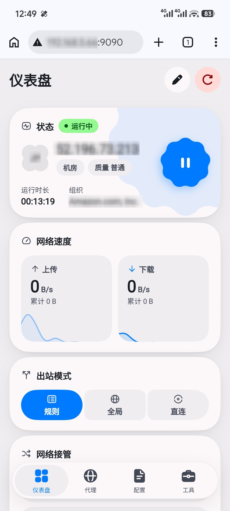

<p align="center">
  
</p>

<h1 align="center">
  <a href="https://github.com/libzonda/FLClash-web">FlClash-web</a>
</h1>

<p align="center">
  A Flutter Web build of <a href="https://github.com/chen08209/FlClash">FlClash</a>
</p>

<p align="center">
  <b>English</b> | <a href="README_zh-CN.md">简体中文</a>
</p>

<p align="center">
  <a href="https://github.com/libzonda/FLClash-web/actions/workflows/flclash-web.yml"></a>
  <a href="https://hub.docker.com/r/libzonda/flclash-web"></a>
  <a href="https://flutter.dev/multi-platform/web"></a>
  <a href="https://go.dev/"></a>
  <a href="https://github.com/libzonda/FLClash-web/releases"></a>
  <a href="LICENSE"></a>
</p>

<p align="center">
  
  
</p>

[More Screenshots](screenshots/)

## 1 Introduction

[FlClash](https://github.com/chen08209/FlClash) is an excellent multi-platform proxy client, but it cannot be easily operated on headless environments such as Linux servers, NAS devices, or soft routers. **FlClash-web compiles the full Flutter UI natively into Flutter Web** (**without VNC or virtual desktop overhead**) and embeds it directly into the Go (Clash.Meta) core binary, delivering a standalone **single executable binary / single Docker container**. It offers minimal resource footprint, zero interaction lag, persistent background proxy execution when closing the browser, and server-side data persistence with zero code intrusion, tracking upstream's latest stable release tags (e.g. `v0.9.2`) automatically during builds.

---

## 2 Quick Start with Docker Compose

Create a `docker-compose.yml` file:

```yaml
services:
  flclash-web:
    image: ghcr.io/libzonda/flclash-web:latest
    container_name: flclash-web
    restart: unless-stopped
    ports:
      - "9090:9090"         # Web UI Dashboard (default 9090)
      - "7890:7890/tcp"     # Clash Mixed Proxy (default 7890, HTTP/SOCKS5)
      - "7890:7890/udp"
    # To enable transparent proxying in TUN mode, uncomment the line below to use host networking:
    # network_mode: host
    environment:
      - TZ=Asia/Shanghai                  # Timezone (default is UTC, recommended local)
      - FLCLASH_WEB_LISTEN=0.0.0.0:9090   # Web listen address (default is 0.0.0.0:9090)
      - FLCLASH_DATA_DIR=/data            # Data directory (default is /data)
    volumes:
      - ./data:/data        # Persistent data storage (default container path is /data)
    # Required only for TUN mode transparent proxying (optional for regular proxy):
    cap_add:
      - NET_ADMIN           # Network administration privileges for TUN
      - NET_RAW
    devices:
      - /dev/net/tun:/dev/net/tun  # TUN device mapping
```

Start the container:

```bash
docker compose up -d
```

- **Web Dashboard URL**: `http://<SERVER_IP>:9090`
- **Proxy Port**: `7890`

---

## 3 Best Practices

### 3.1 Configure Core Auto-start
To ensure the proxy core starts automatically after container launch or server reboot without requiring manual activation via the Web UI:
- Open the Web UI, navigate to **Tools** -> **General** -> **Startup & Background** -> enable **Auto Run**.

### 3.2 Bypass Router Mode (Macvlan Dedicated IP)
Using Docker Macvlan to assign a dedicated LAN IP to FlClash-web avoids host port conflicts (such as port 53 occupied by systemd-resolved) and seamlessly routes traffic for LAN devices.

#### Step 1: Create Macvlan Network
Run on your host machine (replace `eth0`, subnet, and gateway with your network parameters):

```bash
# 1. Enable promiscuous mode on the host network interface
sudo ip link set eth0 promisc on

# 2. Create Docker macvlan network
docker network create -d macvlan \
  --subnet=192.168.1.0/24 \
  --gateway=192.168.1.1 \
  -o parent=eth0 flclash_net
```

#### Step 2: Deploy Container with Dedicated IP
Create `docker-compose.yml` (assuming assigned IP is `192.168.1.200`):

```yaml
services:
  flclash-web:
    image: ghcr.io/libzonda/flclash-web:latest
    container_name: flclash-web
    restart: unless-stopped
    networks:
      flclash_net:
        ipv4_address: 192.168.1.200   # Dedicated LAN IP for FlClash
    cap_add:
      - NET_ADMIN
      - NET_RAW
    devices:
      - /dev/net/tun:/dev/net/tun
    volumes:
      - ./data:/data
    environment:
      - TZ=Asia/Shanghai
      - FLCLASH_WEB_LISTEN=0.0.0.0:9090
      - FLCLASH_DATA_DIR=/data

networks:
  flclash_net:
    external: true
```

#### Step 3: Configure FlClash Panel and Target Devices
1. **Enable Port 53 DNS Listening**:
   - Access `http://192.168.1.200:9090`, go to **Tools** -> **Advanced Settings** -> **DNS**;
   - Click **Add Override** -> change **Listen Address** to `0.0.0.0:53` and save, then enable **TUN Mode**.
2. **Target Device Network Configuration (PC / Phone / TV)**:
   - Configure IPv4 manually:
     - **Gateway**: `192.168.1.200`
     - **Preferred DNS**: `192.168.1.200`

---

## 4 Build from Source

No local Flutter or Go development environment is required. You can build the container image directly via Docker multi-stage build:

```bash
# 1. Clone repository with submodules
git clone --recursive https://github.com/libzonda/flclash-web.git
cd flclash-web

# 2. Build Docker image (automatically pulls and builds upstream's latest stable tag)
docker build -t flclash-web:latest .
```

---

## License & Acknowledgments

- This project is licensed under the [GPL-3.0 License](LICENSE).
- Special thanks to the upstream project [FlClash](https://github.com/chen08209/FlClash) and its author [chen08209](https://github.com/chen08209).
