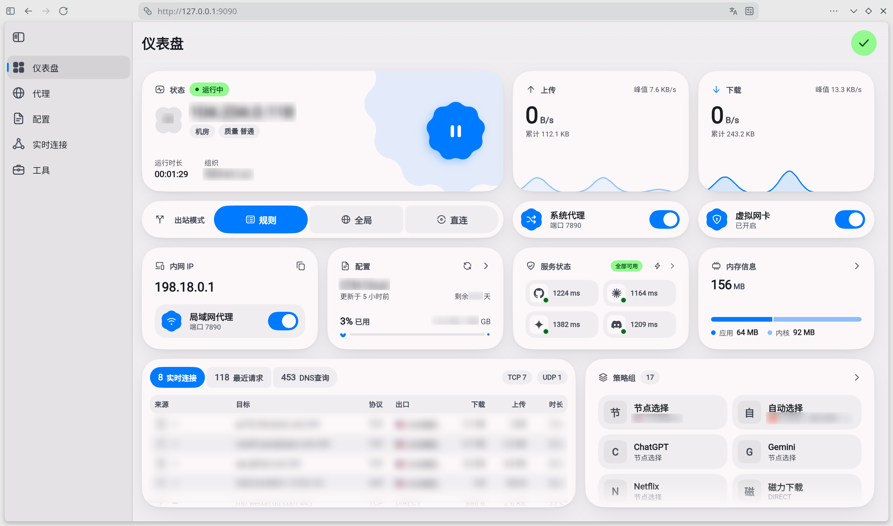

<p align="center">
  
</p>

<h1 align="center">
  <a href="https://github.com/libzonda/FLClash-web">FlClash-web</a>
</h1>

<p align="center">
  A Flutter Web build of <a href="https://github.com/chen08209/FlClash">FlClash</a>
</p>

<p align="center">
  <a href="https://hub.docker.com/r/libzonda/flclash-web"></a>
  <a href="https://github.com/libzonda/FLClash-web/releases"></a>
  <a href="LICENSE"></a>
</p>



[More Screenshots / 更多截图](screenshots/)

## 1 Introduction

[FlClash](https://github.com/chen08209/FlClash) is an excellent multi-platform proxy client, but it cannot be easily operated on headless environments such as Linux servers, NAS devices, or soft routers. FlClash-web compiles the full Flutter UI natively into Flutter Web (**no VNC or virtual desktop overhead**) and embeds it directly into the Go (Clash.Meta) core binary, delivering a standalone **single executable binary / single Docker container**. It offers minimal resource footprint, zero interaction lag, persistent background proxy execution when closing the browser, and server-side data persistence with zero code intrusion, tracking upstream's latest stable release tags (e.g. `v0.9.2`) automatically during builds.

---

## 2 Quick Start with Docker Compose

Create a `docker-compose.yml` file:

```yaml
services:
  flclash-web:
    image: libzonda/flclash-web:latest
    container_name: flclash-web
    restart: unless-stopped
    ports:
      - "9090:9090"         # Web UI Dashboard (default 9090)
      - "7890:7890/tcp"     # Clash Mixed Proxy (default 7890, HTTP/SOCKS5)
      - "7890:7890/udp"
    # To enable transparent proxying in TUN mode, uncomment the line below to use host networking:
    # network_mode: host
    environment:
      - TZ=Asia/Shanghai                  # Timezone (default is UTC, recommended local)
      - FLCLASH_WEB_LISTEN=0.0.0.0:9090   # Web listen address (default is 0.0.0.0:9090)
      - FLCLASH_DATA_DIR=/data            # Data directory (default is /data)
    volumes:
      - ./data:/data        # Persistent data storage (default container path is /data)
    # Required only for TUN mode transparent proxying (optional for regular proxy):
    cap_add:
      - NET_ADMIN           # Network administration privileges for TUN
      - NET_RAW
    devices:
      - /dev/net/tun:/dev/net/tun  # TUN device mapping
```

Start the container:

```bash
docker compose up -d
```

- **Web Dashboard URL**: `http://<SERVER_IP>:9090`
- **Proxy Port**: `7890`

---

## 3 Build from Source

No local Flutter or Go development environment is required. You can build the container image directly via Docker multi-stage build:

```bash
# 1. Clone repository with submodules
git clone --recursive https://github.com/libzonda/flclash-web.git
cd flclash-web

# 2. Build Docker image (automatically pulls and builds upstream's latest stable tag)
docker build -t flclash-web:latest .
```

---

## License & Acknowledgments

- This project is licensed under the [GPL-3.0 License](LICENSE).
- Special thanks to the upstream project [FlClash](https://github.com/chen08209/FlClash) and its author [chen08209](https://github.com/chen08209).

---

# 简体中文

## 1 项目介绍

[FlClash](https://github.com/chen08209/FlClash) 是一款出色的跨平台代理客户端，但在 Linux 服务器、NAS 或软路由等无图形界面环境下难以远程使用。本项目通过原生 Flutter Web 编译（**非 VNC / 远程桌面方案**），将完整的 UI 界面直接内嵌至 Go (Clash.Meta) 核心中，实现**单个可执行文件 / 单个 Docker 容器**开箱即用。具备资源占用低、交互零延迟、浏览器关闭不影响后台代理运行、数据服务端持久化等优点，且代码零侵入，构建时自动跟随上游最新稳定 Release Tag（如 `v0.9.2`）。

---

## 2 Docker Compose 快速部署

创建 `docker-compose.yml`：

```yaml
services:
  flclash-web:
    image: libzonda/flclash-web:latest
    container_name: flclash-web
    restart: unless-stopped
    ports:
      - "9090:9090"         # Web UI 控制面板端口（默认 9090）
      - "7890:7890/tcp"     # Clash 混合代理端口（默认 7890，HTTP/SOCKS5）
      - "7890:7890/udp"
    # 如需 TUN 模式透明代理，建议取消下一行注释使用 host 网络模式：
    # network_mode: host
    environment:
      - TZ=Asia/Shanghai                  # 容器时区（镜像默认 UTC，建议指定本地时区）
      - FLCLASH_WEB_LISTEN=0.0.0.0:9090   # Web 监听地址（镜像默认即为 0.0.0.0:9090）
      - FLCLASH_DATA_DIR=/data            # 数据存储路径（镜像默认即为 /data）
    volumes:
      - ./data:/data        # 持久化配置与节点数据（容器内默认路径为 /data）
    # 以下为 TUN 模式所需权限与虚拟网卡设备（若仅使用普通端口代理可不配）：
    cap_add:
      - NET_ADMIN           # TUN 模式网络管理权限
      - NET_RAW
    devices:
      - /dev/net/tun:/dev/net/tun  # TUN 设备映射
```

启动容器：

```bash
docker compose up -d
```

- **Web 访问地址**：`http://<服务器IP>:9090`
- **代理端口**：`7890`

---

## 3 自行构建方式

宿主机无需安装 Flutter 和 Go 环境，直接使用 Docker 多阶段构建即可：

```bash
# 1. 克隆代码（递归拉取子模块）
git clone --recursive https://github.com/libzonda/flclash-web.git
cd flclash-web

# 2. 一键构建 Docker 镜像（自动拉取上游最新稳定 Tag 编译）
docker build -t flclash-web:latest .
```

---

## 开源协议与致谢

- 本项目基于 [GPL-3.0 License](LICENSE) 开源。
- 特别感谢原项目 [FlClash](https://github.com/chen08209/FlClash) 及其作者 [chen08209](https://github.com/chen08209)。

